  

  
   
  
  &nbsp;
  
  &nbsp;
  

---

### 🧠 About Me

CSE undergrad turning random ideas into working projects. Currently exploring **Software Engineering, AI, Linux, and Backend Development** — while grinding **DSA** one problem at a time.

- 💻 **Software Engineering** — building practical applications and developer tools
- 🧩 **DSA & Problem Solving** — sharpening problem-solving skills with C++
- 🤖 **AI / ML** — experimenting with local LLMs and autonomous agents
- 🐧 **Linux** — terminals, networking, system internals, and breaking my own setup
- 🌐 **Backend & APIs** — building services and learning how applications communicate
- 🚀 **Aerospace & Astronomy** — because apparently Earth isn't enough

---

### 🛠️ Tech Stack & Tools

  
  
  
  
  
  
  
  
  
  

---

### 🎏 Contributions — the pond grows with every commit

  

🐟 The pond refreshes every night. Each square is a day; the koi are just passing through.

---

### 🚀 What I'm Building

| 🤖 AI & Developer Projects | 🌐 Backend & Web | 🧠 DSA Journey |
| :--- | :--- | :--- |
| Experimenting with local AI, LLMs, autonomous agents, and developer utility tools. | Building robust backend services with Python & FastAPI, learning how systems fit under the hood. | Grinding problems, learning patterns, and discovering the bug was one `<=` all along. |

---

### 📈 My Current Quest

*The percentages are questionable. The grind isn't.*

| Skill | Progress | % | Status |
| :--- | :--- | ---: | :--- |
| **DSA & C++** |  | **85%** | `Grinding Patterns` |
| **Programming** |  | **90%** | `Building & Coding` |
| **Linux & Systems** |  | **75%** | `Tweaking & Terminals` |
| **Backend & APIs** |  | **60%** | `Designing Services` |
| **AI / ML & LLMs** |  | **60%** | `Experimenting` |

---

### 🌌 Beyond Code

When I'm not coding, you'll find me exploring astronomy, aerospace technology, UI/UX design, or engaging in completely unnecessary Linux customisations. I like understanding what's happening under the hood, not just making something work.

> **🔭 The Long-Term Mission**
>
> **Idea → Architecture → Code → Application**
>
> *While actually understanding what's happening along the way. And maybe building something cool enough to send to space someday. 🚀*

  

